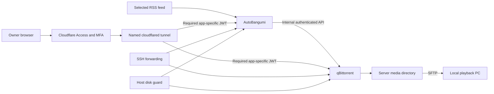

# Design and evidence

## Data flow

AutoBangumi selects, tracks and renames releases; qBittorrent handles transfer and torrent state. The PC plays downloaded files directly. The server does not transcode, run a media library service or automatically synchronize a viewing device. Administrative traffic and media transfer use separate paths.

## Decisions

| Decision | Reason and practical limit |
| --- | --- |
| Pinned image tag plus OCI index digest | Reproducible software across supported architectures; updates require review |
| Loopback-only admin bindings | Straightforward host automation and SSH access; requires modern Docker and trusted host administration |
| Separate app passwords plus optional Access/MFA | Access controls external entry; app authentication remains required internally |
| One narrowly trusted proxy address | Avoids trusting an entire Docker network for forwarded client information |
| Per-ingress Access JWT validation | Required on each application route with its own audience; catchall routes return 404 |
| Manual transfer and retention | Fits local playback and lets operators decide what to keep; requires deliberate cleanup |
| Bounded transfer rates and a persistent guard hold | Limits normal growth between samples; not a hard disk quota |
| Consistent encrypted state snapshots | Preserve databases, sessions and torrent state while keeping recovery keys off-server |
| Guarded, new-directory restoration | Reduces accidental overwrite/restart risk; media and external account resources need separate restoration |

Chinese subtitle preference and reviewed raw fallback are **per-show source-selection choices**, not guaranteed automatic language detection. The template does not promise to find the best release, upgrade every episode automatically, or distinguish native 4K from upscale labels. Start with one source/variant and inspect real results.

## Validation scope

The original application combination was deployed with a named Cloudflare Tunnel. Anonymous API/session rejection, required MFA configuration, per-application audience routing, direct-origin mutation behavior and event streaming were checked; the owner confirmed browser access. This repository excludes that deployment's domain, email, IP addresses, resource identifiers, secrets, logs, verification artifacts and research PDF.

The reusable template is separately tested with non-default ports, a distinct Docker project, and external state/media directories. Its application checks cover health, versions, generated credentials, factory-password rejection, unauthenticated API denial, Host/CSRF protection, narrow proxy trust and AutoBangumi-to-qBittorrent authentication. Lifecycle checks cover running/held backups, a persisted stop, explicit resume and full SQLite/WAL recovery into a new directory.

CI runs unit/lint/repository checks and disposable Docker lifecycle tests. No media, real RSS subscription, Cloudflare credentials or production host access is required. Native runner architecture is visible in the workflow. Actual feed quality, episode completion/renaming, subtitle playback, ISP/provider behavior and a full host reboot remain deployment-specific acceptance tasks.

## Compatibility findings

- qBittorrent's Qt INI parser treats unquoted semicolons as comments. The preseeded allowed-host list is quoted.
- A successful qBittorrent login may return HTTP 204 with an empty body. The helper proves authentication through a protected endpoint. CSRF rejection may be HTTP 401.
- AutoBangumi's configuration update replaces a full model and restores masked secrets. The helper preserves the complete model when updating its downloader port.
- AutoBangumi's `.ab_owner` marker is regenerable and may be owned by root. The backup excludes it before reading files.
- SQLite can keep schema and committed data in its WAL while the main database is very small. Recovery includes and verifies the full data directory.

## Primary sources and upstream licenses

- [qBittorrent releases](https://www.qbittorrent.org/news) and [5.2.3 web application source](https://github.com/qbittorrent/qBittorrent/blob/release-5.2.3/src/webui/webapplication.cpp).
- [LinuxServer qBittorrent image documentation](https://docs.linuxserver.io/images/docker-qbittorrent/) for ownership, ports and container behavior.
- [AutoBangumi 3.3.5 release](https://github.com/EstrellaXD/Auto_Bangumi/releases/tag/3.3.5) and [configuration API source](https://github.com/EstrellaXD/Auto_Bangumi/blob/2befeb49339c1505aba7d821fada34c8371ed536/backend/src/module/api/config.py).
- [Cloudflare Tunnel API](https://developers.cloudflare.com/cloudflare-one/networks/connectors/cloudflare-tunnel/get-started/create-remote-tunnel-api/), [origin parameters](https://developers.cloudflare.com/cloudflare-one/networks/connectors/cloudflare-tunnel/configure-tunnels/origin-parameters/) and [independent MFA](https://developers.cloudflare.com/cloudflare-one/access-controls/access-settings/independent-mfa/).
- [SQLite write-ahead logging](https://sqlite.org/wal.html) and [age](https://github.com/FiloSottile/age) for recovery primitives.

The repository's MIT license covers its original scripts and documentation. It does not relicense qBittorrent, the LinuxServer image, AutoBangumi, cloudflared, age or Docker. Refer to their repositories for their respective licenses. No upstream application source or binary is vendored here.
